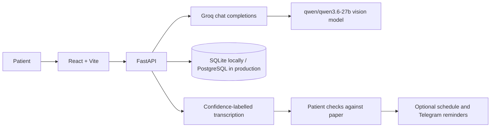

# Dawa Saathi

Dawa Saathi uses Groq with the vision-capable `qwen/qwen3.6-27b` model to transcribe handwritten or printed prescription images into a readable draft. It shows field confidence, keeps unclear values blank, and can build a schedule only when the extracted fields meet the confidence threshold and the user acknowledges checking the draft against the original prescription.

**This is AI transcription, not medical advice or clinician verification.** The app does not diagnose, recommend alternatives, change doses, or generate medicine precautions. Any notes shown as precautions are only text visibly transcribed from the prescription. If a field is unclear or differs from the paper, do not rely on it; contact the prescribing clinician.

## Local setup

1. Install Python 3.11+ and Node.js 20+.
2. Copy `.env.example` to the repository root as `.env`. Set `GROQ_API_KEY`; keep `GROQ_MODEL=qwen/qwen3.6-27b` so image input is supported.
3. In `backend`, create and activate a virtual environment, then run `pip install -e '.[dev]'`.
4. From `backend`, run `alembic upgrade head` and `uvicorn app.main:app --reload`.
5. In `frontend`, copy `.env.example` to `.env`, then run `npm install` and `npm run dev`.

For a clearly marked synthetic schedule demo, run `python -m scripts.seed_demo` from `backend` and look up `DEMO01`. To transcribe an image from the CLI, run `python -m scripts.groq_cli path/to/image.jpg` from `backend`.

## Architecture

The medicine list is a small starter set of names, not a source of dosing facts. See [docs/SAFETY.md](docs/SAFETY.md), [docs/EVAL.md](docs/EVAL.md), and [docs/ISSUES.md](docs/ISSUES.md).

## Limitations

Handwriting accuracy varies and confidence is not proof of correctness. The current self-acknowledgement is not a medical review. Hindi and Marathi voice quality depends on the device. Telegram is optional and intended for demo use. This is not a certified medical device or a substitute for professional advice. Never commit real patient data or API keys.

## Evaluation

No consented, de-identified evaluation set or measured run is included yet. See `docs/EVAL.md`; do not treat placeholder values as measured results.
