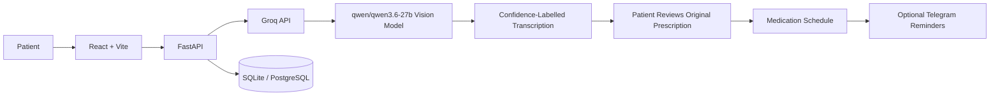

# Dawa Saathi 💊

Dawa Saathi uses Groq with the vision-capable `qwen/qwen3.6-27b` model to convert handwritten and printed prescription images into readable, structured drafts. It provides field-level confidence indicators, leaves unclear values blank instead of guessing, and supports medication scheduling only after the extracted details meet the required confidence threshold and the user confirms reviewing the draft against the original prescription.

**⚠️ This is AI-assisted prescription transcription, not medical advice or clinical verification.**

Dawa Saathi does not diagnose conditions, recommend alternative medicines, change dosages, or generate medical precautions. Any precautions displayed are limited to text visibly transcribed from the prescription. If any medicine name, dosage, or instruction is unclear or differs from the original prescription, consult the prescribing clinician or pharmacist before relying on it.

## Local Setup

1. Install Python 3.11+ and Node.js 20+.

2. Copy `.env.example` to `.env` in the repository root and configure `GROQ_API_KEY`. Keep `GROQ_MODEL=qwen/qwen3.6-27b` to use the vision-capable model.

3. From the `backend` directory, create and activate a virtual environment, then install dependencies:

   ```bash
   pip install -e ".[dev]"
   ```

4. Run database migrations and start the backend:

   ```bash
   alembic upgrade head
   uvicorn app.main:app --reload
   ```

5. In the `frontend` directory, copy `.env.example` to `.env`, configure the required environment variables, and start the frontend:

   ```bash
   npm install
   npm run dev
   ```

**Demo & CLI**

To create a clearly labelled synthetic schedule demo, run `python -m scripts.seed_demo` from `backend` and look up `DEMO01`.

To transcribe a prescription image from the command line, run `python -m scripts.groq_cli path/to/image.jpg` from `backend`.

## Architecture



The medicine list is a starter reference, not an authoritative source of medical or dosing information. See [`docs/SAFETY.md`](docs/SAFETY.md), [`docs/EVAL.md`](docs/EVAL.md), and [`docs/ISSUES.md`](docs/ISSUES.md) for safety guidelines, evaluation plans, and known limitations.

## Limitations

Prescription transcription accuracy varies with handwriting, image quality, and model performance. Confidence scores do not guarantee correctness, and user acknowledgement does not constitute medical verification. Hindi and Marathi voice quality depends on device and browser capabilities. Telegram reminders are optional and intended for demonstration use.

Dawa Saathi is a prototype, not a certified medical device or a substitute for professional medical advice. Never commit real patient data, prescription images containing personal information, or API keys.

## Evaluation

No consented, de-identified evaluation dataset or measured performance results are currently included. Evaluation should cover field-level extraction accuracy, critical-field errors, uncertainty handling, and end-to-end reliability.

See [`docs/EVAL.md`](docs/EVAL.md) for the evaluation approach. Placeholder values must not be presented as measured results.
